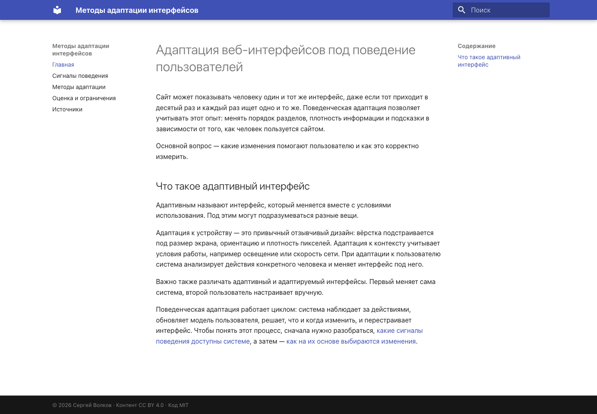
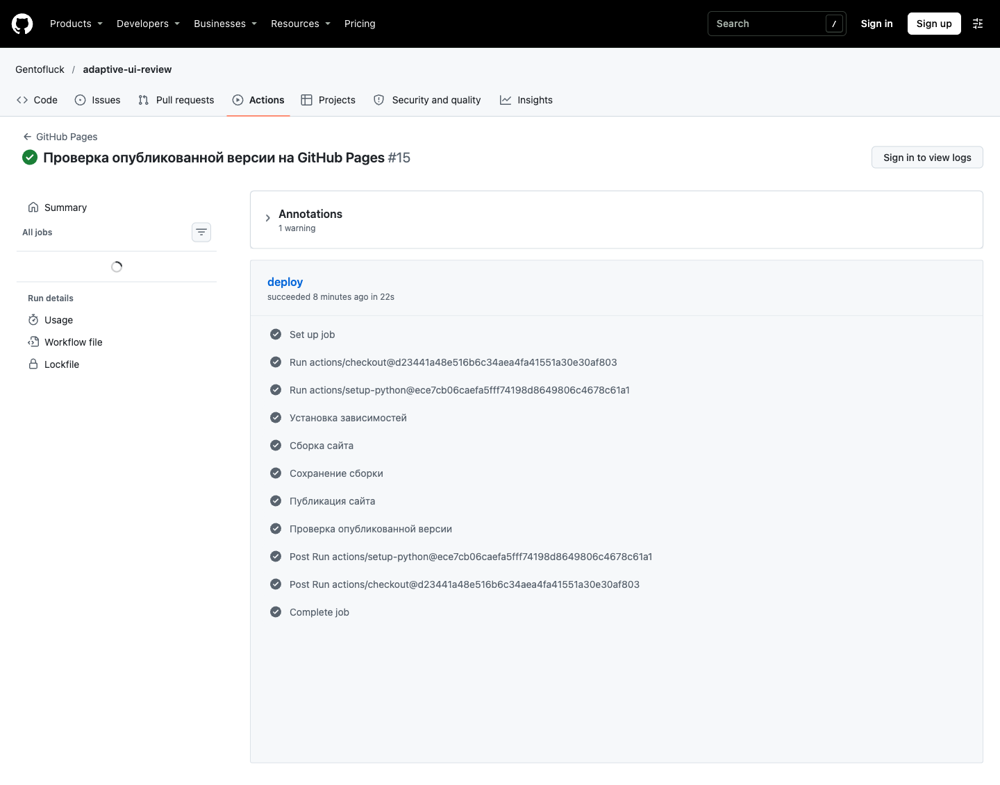
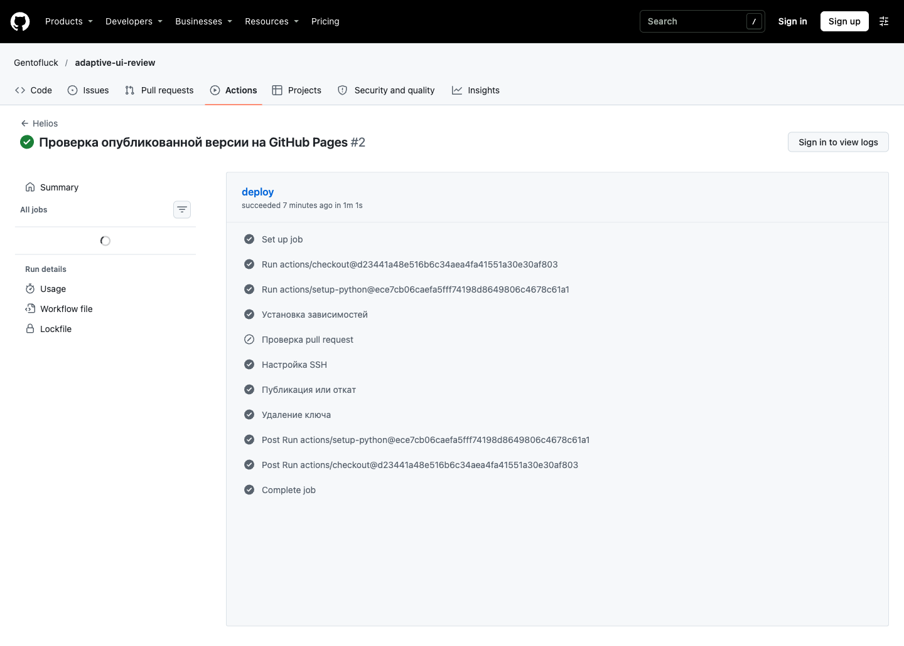
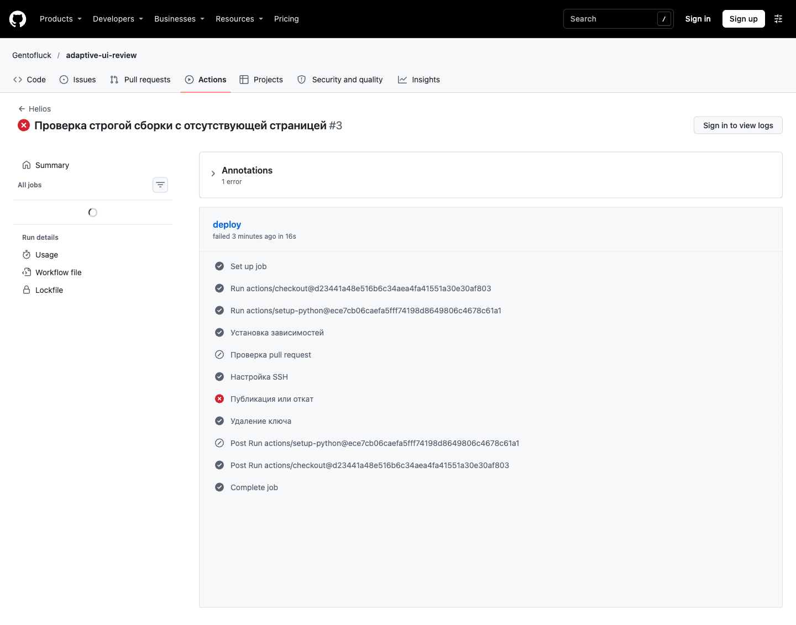

# Отчёт по заданию 1

[GitHub Pages](https://gentofluck.github.io/adaptive-ui-review/)
[Helios](https://se.ifmo.ru/~s336456/adaptive-interfaces-review/)

## Подготовка сайта

Для сайта выбрал тему «Методы адаптации веб-интерфейсов под поведение пользователей». Взял теоретическую часть своей НИР.

- Виртуальное окружение Python 3.15.2
- Использую MkDocs с темой Material
- Версии пакетов закрепил в [requirements.txt](requirements.txt)

Код распространяется по [MIT](LICENSE), авторские тексты — по [CC BY 4.0](LICENSE-CONTENT).

## Публикация и проверки

Настроены два workflow: [GitHub Pages](.github/workflows/deploy.yml) и [Helios](.github/workflows/deploy-helios.yml). После отправки изменений в `main` Actions собирает сайт и публикует его на обеих площадках. Для Pages используются `upload-pages-artifact` и `deploy-pages`, на Helios файлы передаются через SSH и rsync. 
Скрипты загрузки и проверки находятся в каталоге [scripts](scripts/).

Сравнение способов публикации и рисков приведено в [T4](report/T4.md), описание выкладки на Helios и отката — в [P4](report/P4.md).

Успешные сборки: [Pages](https://github.com/Gentofluck/adaptive-ui-review/actions/runs/43745332796) и [Helios](https://github.com/Gentofluck/adaptive-ui-review/actions/runs/43745332799). После публикации обе страницы отдавали HTTP 200 и метку версии `7d39b7499a02`.

В отдельной ветке добавил ссылку на отсутствующую страницу. [Сборка](https://github.com/Gentofluck/adaptive-ui-review/actions/runs/43745823486) завершилась ошибкой до подключения к серверу. После удаления ссылки следующая сборка прошла.

## Отладка

### Параметр rsync на macOS

При передаче файлов команда завершилась сообщением `rsync: --chmod=D755,F644: invalid argument`. Проверил её без `--chmod`: пробный запуск rsync прошёл. Параметр убрал из команды; права на сервере задаются отдельным `chmod`.

### Запрос темы к GitHub API

В Network обнаружил запрос виджета Material к `api.github.com/repos/Gentofluck/adaptive-ui-review/releases/latest`, который вернул `404`. Предположил, что запрос создаёт `repo_url`. Отключил настройку и сравнил варианты: запросы пропали, а поиск и формула продолжили работать при блокировке внешних адресов. Поэтому виджет оставил выключенным. Сравнение и снимок запроса приведены в [T4](report/T4.md).

### Битая ссылка в строгой сборке

Чтобы проверить поведение CI, добавил ссылку на отсутствующий `missing-check.md`. Сборка завершилась с сообщением `Aborted with 1 warnings in strict mode!`; передача на Helios не запускалась. После удаления ссылки сборка прошла.

## Вывод

MkDocs с темой Material подходит для публикации документации и статей: страницы пишутся в Markdown, меню и поиск уже есть. Обновление сайта можно поручить GitHub Actions, а готовые файлы разместить на GitHub Pages или любом веб-хостинге.

Если нужны учётные записи, работа с базой данных или обработка запросов на сервере, одного MkDocs будет недостаточно.
