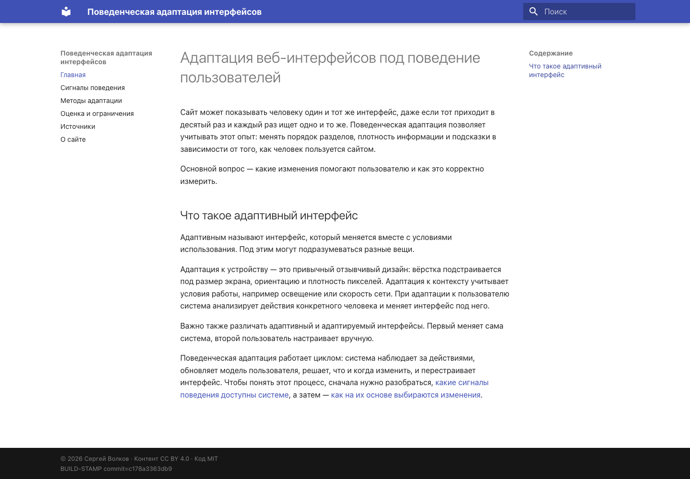
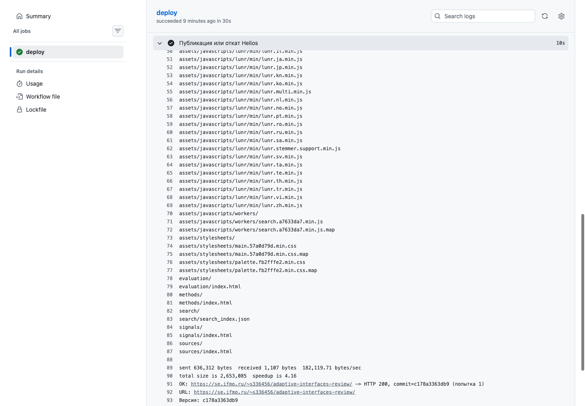
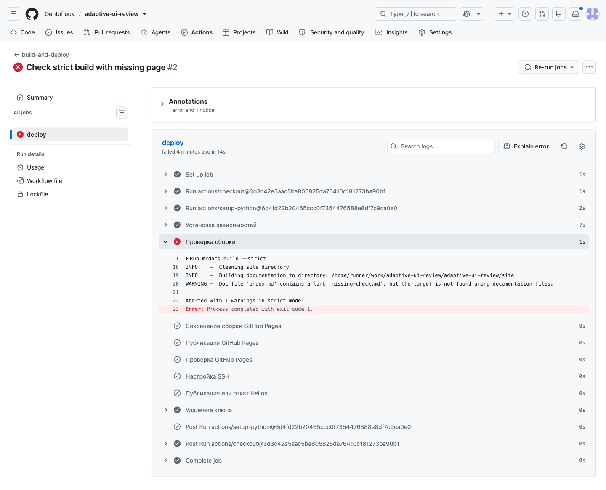

# Отчёт по заданию 1

[Репозиторий](https://github.com/Gentofluck/adaptive-ui-review) · [GitHub Pages](https://gentofluck.github.io/adaptive-ui-review/) · [Helios](https://se.ifmo.ru/~s336456/adaptive-interfaces-review/).

## Подготовка сайта

Для сайта выбрал тему «Методы адаптации интерфейсов под поведение пользователей». Взял теоретическую часть своей НИР.

Сайт собран на MkDocs с темой Material.

Код распространяется по [MIT](LICENSE), авторские тексты — по [CC BY 4.0](LICENSE-CONTENT).

## Публикация

Публикация настроена в [deploy.yml](.github/workflows/deploy.yml). После отправки изменений в ветку `main` GitHub Actions автоматически собирает сайт и обновляет его на GitHub Pages и Helios. Для Pages используются готовые действия GitHub, а на Helios файлы загружаются через rsync.

Порядок загрузки файлов, отдельные версии для веток и откат описаны в [P4](report/P4.md). Сравнение способов доставки и проверка внешних ресурсов приведены в [T4](report/T4.md).

## Проверки

[Запуски публикации](https://github.com/Gentofluck/adaptive-ui-review/actions/workflows/deploy.yml).

[Успешный запуск](https://github.com/Gentofluck/adaptive-ui-review/actions/runs/42879463837) завершил публикацию на обе площадки. Проверка после загрузки подтвердила наличие ожидаемой версии по метке `BUILD-STAMP`.

Для проверки защиты от ошибок отдельно добавил неверную ссылку. [Этот запуск](https://github.com/Gentofluck/adaptive-ui-review/actions/runs/42879457712) завершился до публикации. После удаления ссылки сборка снова прошла.

## Отладка

### Передача файлов с macOS

При загрузке сайта возникла ошибка `rsync: --chmod=D755,F644: invalid argument`. Предположил, что дело в версии rsync на Mac, и повторил команду без `--chmod` — файлы передались. Теперь права задаются отдельной командой на сервере.

### Запросы темы к GitHub

В Network обнаружил запрос к `releases/latest` с ответом `404 Not Found`. Он мог быть связан с виджетом репозитория в Material. Убрал настройку `repo_url` и перезагрузил страницу: запрос исчез. Виджет оставил отключённым; скриншот есть в [T4](report/T4.md#зависимость-от-внешних-ресурсов).

### Неверная ссылка

Для проверки сборки добавил ссылку на отсутствующий `missing-check.md`.
В Actions появилась ошибка `Aborted with 1 warnings in strict mode!`; после удаления ссылки сборка прошла.

## Вывод

MkDocs с темой Material подходит для публикации документации и статей: страницы пишутся в Markdown, меню и поиск уже есть. Обновление сайта можно поручить GitHub Actions, а готовые файлы разместить на GitHub Pages или любом веб-хостинге.

Если нужны учётные записи, работа с базой данных или обработка запросов на сервере, одного MkDocs будет недостаточно.
