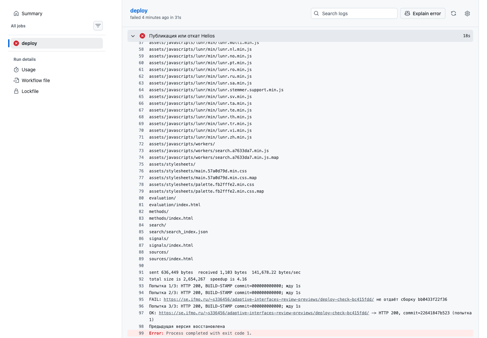

# P4. Публикация на Helios

## Публикация

[Workflow](../.github/workflows/deploy.yml) запускается после push и сначала проверяет сайт командой `mkdocs build --strict`.
Из `main` он публикует основные версии на GitHub Pages и Helios. Для остальных веток создаёт отдельный сайт на Helios, чтобы проверить изменения до слияния. При событии pull request выполняется только сборка.

### Замена версии на Helios

[Скрипт](../scripts/deploy-helios.sh) использует три каталога на сервере:

```text
public_html/adaptive-interfaces-review/
public_html/adaptive-interfaces-review.next/
public_html/adaptive-interfaces-review.previous/
```

Первый содержит опубликованный сайт. В каталог с суффиксом `.next` через rsync загружается новая сборка. Пока идёт передача, основной сайт продолжает работать с прежними файлами.

После полной загрузки текущий каталог переименовывается в `.previous`, а `.next` получает имя основного каталога. Поэтому после успешной публикации папки `.next` нет, а в `.previous` остаётся версия для отката. При следующем обновлении она заменяется.

Затем [healthcheck](../scripts/healthcheck.sh) запрашивает сайт и проверяет HTTP 200 и хеш сборки. Если проверка не проходит, скрипт возвращает сохранённую версию и завершает запуск с ошибкой.

### Ручной откат

Во вкладке Actions нужно выбрать `build-and-deploy` и нажать Run workflow. В открывшейся форме указать ветку `main` и действие `rollback`. Скрипт поменяет местами основной каталог Helios и `.previous`, затем проверит восстановленный сайт. Репозиторий и GitHub Pages при этом не меняются.

Действие `deploy` в той же форме заново собирает и публикует код выбранной ветки.

## Проверки

Проверки выполнены 10 ноября 2026 года.

| Проверка | Результат |
|---|---|
| [Production-деплой](https://github.com/Gentofluck/adaptive-ui-review/actions/runs/42879463837) | Обе площадки вернули HTTP 200 и метку `c178a3363db9` |
| [Preview](https://github.com/Gentofluck/adaptive-ui-review/actions/runs/42879640687) | [Отдельный сайт](https://se.ifmo.ru/~s336456/adaptive-interfaces-review-previews/deploy-check-bc415fdd/) содержит надпись `PREVIEW_CHECK_2026`; в основной версии её нет |
| [Ручной rollback](https://github.com/Gentofluck/adaptive-ui-review/actions/runs/42879779138) | Helios вернулся на `cc3bb9b43741`, Pages остался на новой версии |
| [Повторный deploy](https://github.com/Gentofluck/adaptive-ui-review/actions/runs/42879915247) | Актуальная версия восстановлена |
| [Битая ссылка](https://github.com/Gentofluck/adaptive-ui-review/actions/runs/42879457712) | Намеренно добавленная ссылка остановила строгую сборку до публикации |
| [Неверная метка](https://github.com/Gentofluck/adaptive-ui-review/actions/runs/42880066107) | Тестовый preview не прошёл healthcheck; автоматически восстановлена предыдущая версия |

В [pull request](https://github.com/Gentofluck/adaptive-ui-review/actions/runs/42880300617) сборка прошла; шаги SSH и публикации были пропущены.

После контрольных ошибок [исправленная ветка](https://github.com/Gentofluck/adaptive-ui-review/actions/runs/42880180069) опубликована успешно.

На снимке preview видна контрольная надпись, которой нет в основной версии:


При ручном откате проверка подтвердила прежнюю метку сборки на Helios:


Скриншоты успешной и остановленной сборки находятся в [основном отчёте](../REPORT.md#проверки).

## Измерения

Время обычной публикации взято из [запуска 42879463837](https://github.com/Gentofluck/adaptive-ui-review/actions/runs/42879463837), время отката — из [42879779138](https://github.com/Gentofluck/adaptive-ui-review/actions/runs/42879779138). Это отдельные наблюдения, не средние значения. Длительность job не включает очередь запуска.

Время локальной команды измерено с уже установленными зависимостями на Python 3.13.2. Размеры относятся к сборке `c178a3363db9` и указаны без сжатия.

| Измерение | Результат |
|---|---:|
| Полная job | 30 с |
| Pages: артефакт, публикация, проверка | 7 с |
| Helios: сборка, доставка, переключение, проверка | 10 с |
| Ручной rollback, полная job | 16 с |
| Локальная команда `mkdocs build --strict` | 0,381 с |
| HTML главной | 16 272 байта |
| Вся сборка без сжатия | 2 653 085 байт |

Данные сохранены в [checks.json](checks.json).

На GitHub Pages доставкой артефакта управляет GitHub; при ошибке смотрю журнал Action и состояние deployment. На Helios передачу файлов и замену каталогов выполняет мой скрипт. Его приходится поддерживать самому, зато по SSH можно проверить файлы и сохранённую версию прямо на сервере. Поведение при неверной метке и ручной откат проверены в запусках выше; по этим отдельным запускам нельзя судить об общей доступности площадок.

## Проверка автоматического восстановления

В тестовой ветке намеренно подставлена неверная метка `BUILD-STAMP`. Страница открывалась с HTTP 200, но healthcheck завершился ошибкой: `FAIL: … не отдаёт сборку bb0433f22f36`. Значит, доступность страницы сама по себе не подтверждает публикацию нужной версии. Скрипт вернул предыдущий preview и проверил его метку `22641847b523`; в журнале появилась запись `Предыдущая версия восстановлена`.



Разбор ошибок сборки и передачи файлов приведён в разделе [«Отладка» основного отчёта](../REPORT.md#отладка).

## Ограничения

Новые файлы загружаются в `.next`, поэтому во время передачи основной сайт продолжает работать с прежней версией. Если соединение прервётся на этом этапе, незавершённая загрузка останется в `.next`.

После загрузки скрипт сначала переименовывает основной каталог в `.previous`, а затем ставит на его место `.next`. Между этими двумя действиями основного каталога некоторое время нет, и запрос к сайту в этот момент может получить ошибку. Если выполнение прервётся в этом промежутке, сайт придётся восстановить из `.previous` вручную. Сетевой обрыв отдельно не воспроизводился; это описание следует из порядка команд в скрипте.

В `.previous` хранится только одна сохранённая версия. При очередной публикации она заменяется той, которая до этого была основной. Откат использует эту папку на Helios; содержимое репозитория и сайта на GitHub Pages при этом не меняется.
