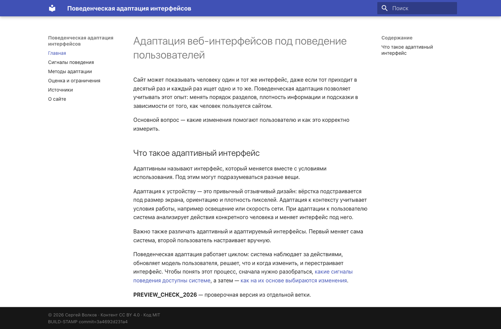
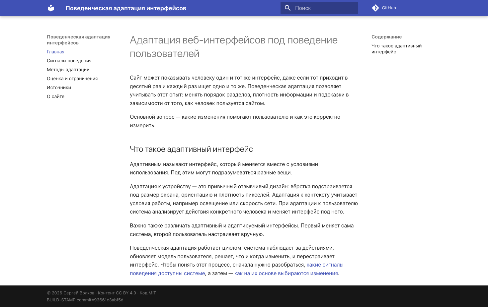

# P4. Публикация на Helios

## Публикация

[Workflow](../.github/workflows/deploy.yml) запускается после push и сначала проверяет сайт командой `mkdocs build --strict`.
Из `main` он публикует основные версии на GitHub Pages и Helios. Для остальных веток создаёт отдельный сайт на Helios, чтобы проверить изменения до слияния. При событии pull request выполняется только сборка.

### Замена версии на Helios

[Скрипт](../scripts/deploy-helios.sh) использует три каталога на сервере:

```text
public_html/adaptive-interfaces-review/
public_html/adaptive-interfaces-review.next/
public_html/adaptive-interfaces-review.previous/
```

Первый содержит опубликованный сайт. В каталог с суффиксом `.next` через rsync загружается новая сборка. Пока идёт передача, основной сайт продолжает работать с прежними файлами.

После полной загрузки текущий каталог переименовывается в `.previous`, а `.next` получает имя основного каталога. Поэтому после успешной публикации папки `.next` нет, а в `.previous` остаётся версия для отката. При следующем обновлении она заменяется.

Затем [healthcheck](../scripts/healthcheck.sh) запрашивает сайт и проверяет HTTP 200 и хеш сборки. Если проверка не проходит, скрипт возвращает сохранённую версию и завершает запуск с ошибкой.

### Ручной откат

Во вкладке Actions нужно выбрать `build-and-deploy` и нажать Run workflow. В открывшейся форме указать ветку `main` и действие `rollback`. Скрипт поменяет местами основной каталог Helios и `.previous`, затем проверит восстановленный сайт. Репозиторий и GitHub Pages при этом не меняются.

Действие `deploy` в той же форме заново собирает и публикует код выбранной ветки.

## Проверки

| Проверка | Результат |
|---|---|
| [Production-деплой](https://github.com/Gentofluck/adaptive-interfaces-review/actions/runs/42521134333) | Обе площадки вернули HTTP 200 и метку `e423dd5fa1e1` |
| [Preview](https://github.com/Gentofluck/adaptive-interfaces-review/actions/runs/42521155081) | Надпись `PREVIEW_CHECK_2026` появилась только в preview |
| [Ручной rollback](https://github.com/Gentofluck/adaptive-interfaces-review/actions/runs/42521238817) | Helios вернулся на `93661e3abf5d`, Pages остался на новой версии |
| [Повторный deploy](https://github.com/Gentofluck/adaptive-interfaces-review/actions/runs/42521326064) | Актуальная версия восстановлена |
| [Битая ссылка](https://github.com/Gentofluck/adaptive-interfaces-review/actions/runs/42521068010) | Намеренно добавленная ссылка остановила строгую сборку до публикации |
| [Неверная метка](https://github.com/Gentofluck/adaptive-interfaces-review/actions/runs/42521492794) | Тестовый preview не прошёл healthcheck; автоматически восстановлена предыдущая версия |

После контрольных ошибок [исправленная ветка](https://github.com/Gentofluck/adaptive-interfaces-review/actions/runs/42521615425) опубликована успешно.

На снимке preview видна контрольная надпись, которой нет в основной версии:



При ручном откате проверка подтвердила прежнюю метку сборки на Helios:



Скриншоты успешной и остановленной сборки находятся в [основном отчёте](../REPORT.md#проверки).

## Измерения

Время обычной публикации взято из [запуска 42521134333](https://github.com/Gentofluck/adaptive-interfaces-review/actions/runs/42521134333), время отката — из [42521238817](https://github.com/Gentofluck/adaptive-interfaces-review/actions/runs/42521238817). Это отдельные наблюдения, не средние значения. Длительность job не включает очередь запуска.

Локальная сборка измерена с уже установленными зависимостями на Python 3.13.2. Размеры относятся к сборке `e423dd5fa1e1` и указаны без сжатия.

| Измерение | Результат |
|---|---:|
| Полная job | 36 с |
| Pages: артефакт, публикация, проверка | 10 с |
| Helios: сборка, доставка, переключение, проверка | 12 с |
| Ручной rollback, полная job | 24 с |
| Локальная строгая сборка | 0,402 с |
| HTML главной | 16 272 байта |
| Вся сборка без сжатия | 2 653 085 байт |

Данные сохранены в [checks.json](checks.json).

## Проверка автоматического восстановления

В тестовой ветке намеренно подставлена неверная метка `BUILD-STAMP`. Страница открывалась с HTTP 200, но healthcheck завершился ошибкой: `FAIL: … не отдаёт сборку 652fd91824d3`. Значит, доступность страницы сама по себе не подтверждает публикацию нужной версии. Скрипт вернул предыдущий preview и проверил его метку `3a4692d231a4`; в журнале появилась запись `Предыдущая версия восстановлена`.

Разбор ошибок сборки и передачи файлов приведён в разделе [«Отладка» основного отчёта](../REPORT.md#отладка).

## Ограничения

Новые файлы загружаются в `.next`, поэтому во время передачи основной сайт продолжает работать с прежней версией. Если соединение прервётся на этом этапе, незавершённая загрузка останется в `.next`.

После загрузки скрипт сначала переименовывает основной каталог в `.previous`, а затем ставит на его место `.next`. Между этими двумя действиями основного каталога некоторое время нет, и запрос к сайту в этот момент может получить ошибку.

В `.previous` хранится только одна сохранённая версия. При очередной публикации она заменяется той, которая до этого была основной. Откат использует эту папку на Helios; содержимое репозитория и сайта на GitHub Pages при этом не меняется.
