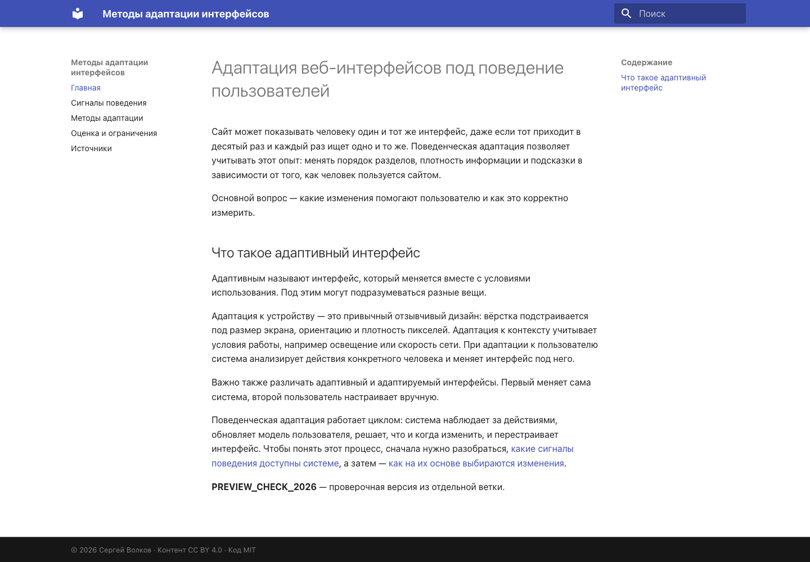
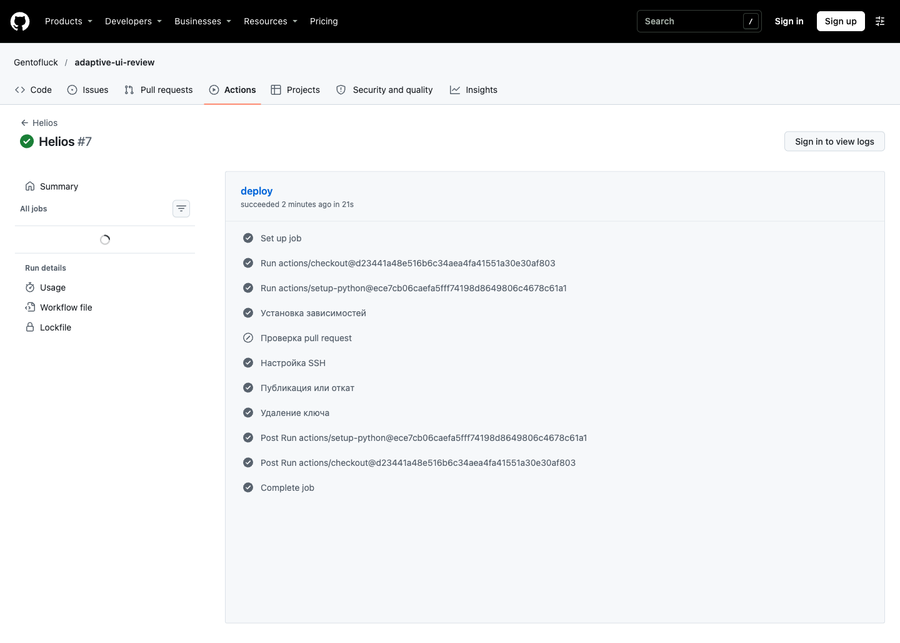
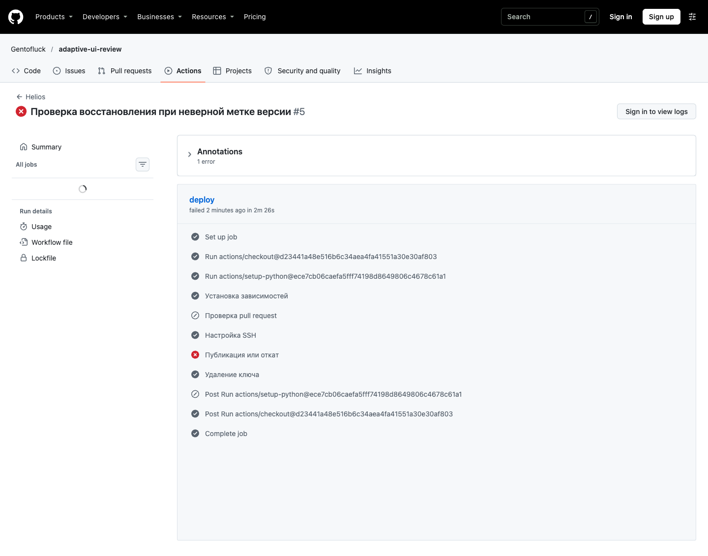

# P4. Публикация на Helios

## Как устроена публикация

Workflow [deploy-helios.yml](../.github/workflows/deploy-helios.yml) сначала выполняет `mkdocs build --strict`. Для pull request на этом работа заканчивается: соединение по SSH и публикация пропускаются. При push в `main` публикуется основная версия; для других веток создаются отдельные каталоги preview на Helios.

Скрипт [deploy-helios.sh](../scripts/deploy-helios.sh) сначала загружает собранный сайт в каталог `.next` рядом с текущим каталогом. После загрузки текущая версия переименовывается в `.previous`, а `.next` становится основным каталогом. Поэтому после успешного обновления `.next` исчезает. В `.previous` остаётся одна предыдущая версия; при следующем обновлении она заменяется.

Затем [healthcheck.sh](../scripts/healthcheck.sh) проверяет HTTP 200 и метку коммита в HTML. Если метка не совпала, скрипт восстанавливает предыдущую версию и завершает запуск ошибкой.

## Ручной откат

Для отката в Actions выбирается workflow `Helios`, ветка `main` и действие `rollback`. Скрипт меняет местами текущий каталог и `.previous`, после чего проверяет метку версии. Откат затрагивает только Helios.

| Проверка | Результат |
|---|---|
| Публикация в `main` | [Pages](https://github.com/Gentofluck/adaptive-ui-review/actions/runs/43745332796) и [Helios](https://github.com/Gentofluck/adaptive-ui-review/actions/runs/43745332799) опубликовали `7d39b7499a02` |
| Preview | [Ветка](https://github.com/Gentofluck/adaptive-ui-review/actions/runs/43746312750) опубликована в отдельном каталоге; контрольная строка есть только в preview |
| Неверная метка preview | [Проверка](https://github.com/Gentofluck/adaptive-ui-review/actions/runs/43746791393) завершилась ошибкой; скрипт вернул предыдущую версию |
| Ручной rollback | [Запуск](https://github.com/Gentofluck/adaptive-ui-review/actions/runs/43747735363) вернул Helios к предыдущей версии; Pages не менялся |
| Повторная публикация | [Запуск](https://github.com/Gentofluck/adaptive-ui-review/actions/runs/43748192832) снова разместил `7d39b7499a02` на Helios |
| Pull request | [Сборка](https://github.com/Gentofluck/adaptive-ui-review/actions/runs/43748671722) прошла; SSH и публикация были пропущены |

## Время и размер сборки

Локальная сборка выполнялась с установленными зависимостями. Размер указан без сжатия.

| Измерение | Результат |
|---|---:|
| Публикация GitHub Pages, job | 22 с |
| Публикация Helios, job | 28 с |
| Локальная `mkdocs build --strict` | 0,21 с |
| Главная страница | 15 724 байта |
| Весь сайт | 2 634 482 байта |

## Сравнение площадок и сбои передачи

В проверенных запусках обе площадки отдали нужную версию. На Pages за передачу и размещение артефакта отвечает сам GitHub: в журнале Actions видны отдельные шаги — сборка, загрузка артефакта, публикация, проверка. Если что-то падает, удобно смотреть job и состояние Pages deployment.

На Helios workflow сам подключается по SSH, заливает файлы и переключает каталоги. В журнале виден результат каждого шага, а по SSH можно заглянуть в текущий и предыдущий каталоги. Контроля над файлами тут больше, но команды публикации и восстановление приходится поддерживать самому.

При обрыве rsync до переключения текущий сайт остаётся на месте, а незавершённые файлы могут остаться в `.next`. 
После загрузки выполняются два переименования. Если процесс остановится между ними, основного каталога временно не будет, и потребуется ручное восстановление из `.previous`.

## Ограничения

Если загрузка в `.next` прервётся, текущая версия останется на месте. После загрузки скрипт выполняет два переименования каталогов. Между ними основного каталога краткое время нет; если процесс остановится в этот момент, его придётся восстановить вручную. Эту ситуацию отдельно не воспроизводил.

На сервере хранится одна версия для отката. При новом обновлении она заменяется. Снимок каталогов после публикации: основной каталог содержит `7d39b7499a02`, `.previous` содержит `0b6eec5f5530`, `.next` отсутствует.
