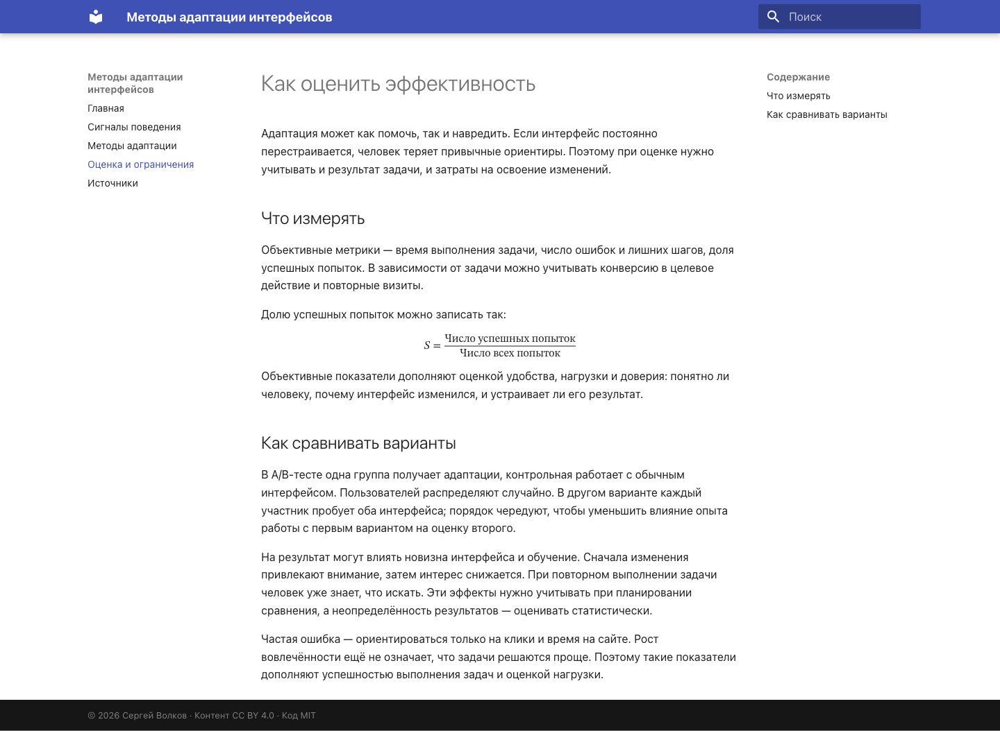

# T4. Доставка и внешние ресурсы

## Способы публикации

| Способ | Необходимый доступ и последствия утечки |
|---|---|
| Push в `gh-pages` | Токен с правом записи в репозиторий. Его утечка позволит менять содержимое в пределах выданных прав |
| Pages artifact | Права на публикацию Pages и подтверждение запуска через `id-token`. При компрометации возможна подмена сайта |
| SSH + rsync/scp | SSH-ключ аккаунта на сервере. С ним можно выполнять команды и изменять доступные аккаунту файлы |
| FTP / SFTP | Доступ к каталогам сервера. Обычный FTP не шифрует передачу; SFTP работает через SSH и требует проверки ключа сервера |
| S3 API | Ключ или временные полномочия на хранилище. Они позволяют изменять и удалять объекты в пределах разрешённого доступа |

В проекте настроены Pages artifact и SSH.

## Запросы Material

Настройка `repo_url` включает в теме виджет репозитория. При проверке браузер отправлял два запроса к GitHub API, в том числе `releases/latest`, который вернул 404, поэтому `repo_url` отключён.

Сравнил две сборки одного коммита `7d39b7499a02`; менялась только настройка `repo_url`. Файлы измерены без HTTP-сжатия.

| Показатель | С виджетом | Без виджета |
|---|---:|---:|
| Запросы к GitHub API | 2 | 0 |
| Главная страница, байт | 17 964 | 15 724 |
| Вся сборка, байт | 2 647 915 | 2 634 482 |
| Индекс поиска, байт | 37 000 | 37 000 |
| Время MkDocs, с | 0,14 | 0,21 |

Формула записана в MathML. 

Поиск также работает.

Исходный замер сохранён в [checks.json](checks.json). Workflow публикации: [deploy.yml](../.github/workflows/deploy.yml) и [deploy-helios.yml](../.github/workflows/deploy-helios.yml).
