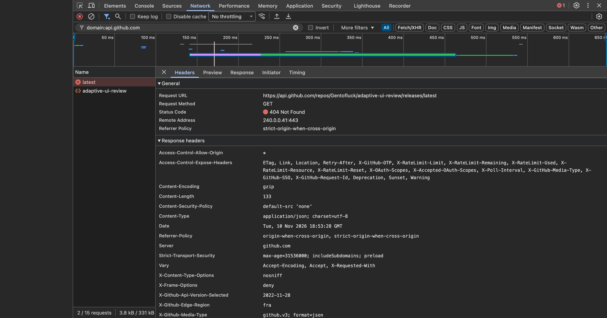
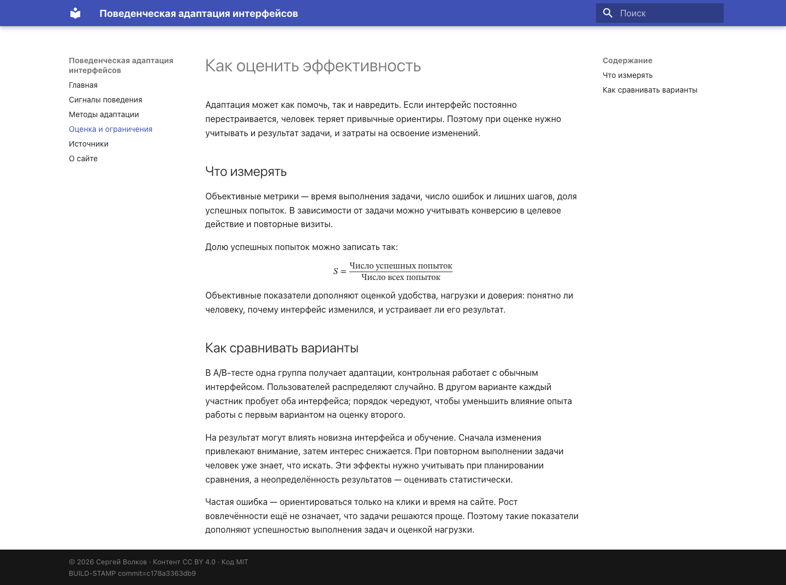
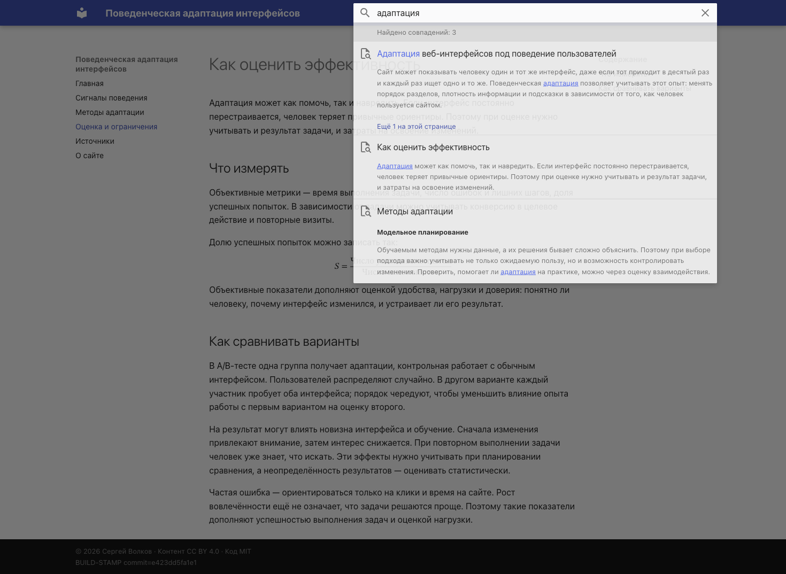

# T4. Доставка и безопасность

## Как публикуется сайт

MkDocs собирает HTML, стили и скрипты из одних исходных материалов для двух площадок. Для GitHub Pages действие `upload-pages-artifact` сохраняет сборку в хранилище GitHub, а `deploy-pages` публикует её. На Helios файлы передаются через rsync по SSH.

## Сравнение способов доставки

| Способ | Необходимый доступ и последствия утечки |
|---|---|
| Push в `gh-pages` | Токен с правом записи в репозиторий. Его утечка позволит менять содержимое в пределах выданных прав |
| Pages artifact | Права на публикацию Pages и подтверждение запуска через `id-token`. При компрометации возможна подмена сайта |
| SSH + rsync/scp | SSH-ключ аккаунта на сервере. С ним можно выполнять команды и изменять доступные аккаунту файлы |
| FTP / SFTP | Доступ к каталогам сервера. Обычный FTP не шифрует передачу; SFTP работает через SSH и требует проверки ключа сервера |
| S3 API | Ключ или временные полномочия на хранилище. Они позволяют изменять и удалять объекты в пределах разрешённого доступа |

В проекте настроены Pages artifact и SSH.
Реализация находится в [deploy.yml](../.github/workflows/deploy.yml).

## Как защищено подключение

Для GitHub Actions создан отдельный SSH-ключ. Его приватная часть хранится в секрете `HELIOS_SSH_KEY`, а публичная добавлена на Helios. При запуске Actions записывает приватный ключ во временный файл и использует его для подключения. После завершения файл удаляется.

Отдельно проверяется сам сервер. В `HELIOS_KNOWN_HOSTS` сохранён ключ из уже проверенного локального `known_hosts`. Настройка `StrictHostKeyChecking yes` не разрешает подключаться, если ответ сервера с ним не совпадает.

GitHub по умолчанию не передаёт секреты репозитория в `pull_request` из форка: автор такого запроса может изменить код сборки и попытаться вывести ключ. Выдаваемый ему `GITHUB_TOKEN` имеет права только на чтение. В этом workflow SSH и публикация дополнительно отключены для всех pull request.

Готовый Action выполняет сторонний код на раннере. Если злоумышленник подменит этот код, он может изменить сборку и опубликовать поддельные страницы, а при доступе к секретам — похитить ключ. Это атака через зависимость пайплайна, или supply-chain-атака. Поэтому версии Actions закреплены полными SHA: тег можно переназначить на другой коммит, а SHA фиксирует конкретный код. Такая фиксация не заменяет проверку самого Action.

SSH-ключ позволяет войти и выполнять команды от имени моего пользователя, поэтому доступ не ограничивается папкой сайта.

## Зависимость от внешних ресурсов

Для оформления используется Material — готовая тема MkDocs. Для сравнения локально включил настройку `repo_url`: тема показала виджет репозитория и отправила запросы к GitHub. Для содержания сайта этот виджет не нужен, поэтому он отключён.

После отключения виджета на главной странице не осталось внешних запросов.

Шрифты используются системные, формула записана в MathML и отображается самим браузером. Стили, скрипты поиска и иконки Material входят в сборку. Если добавить библиотеку с CDN, её файлы можно сохранить в `docs/assets/` и подключить по локальному пути. В текущей версии таких библиотек нет: работа поиска и формулы проверена при блокировке внешних запросов.

Сравнение выполнено для версии `c178a3363db9`. Изменялась только настройка `repo_url`; зависимости, исходные страницы и остальные параметры совпадали. Размеры файлов указаны без HTTP-сжатия.

| Измерение | С виджетом | Без виджета |
|---|---:|---:|
| Внешние запросы на главной | 2 | 0 |
| HTML главной, байт | 18 505 | 16 272 |
| Вся сборка, байт | 2 668 716 | 2 653 085 |

Проверка формулы при недоступных внешних ресурсах:

Поиск по слову «адаптация» в тех же условиях нашёл страницы сайта:

Исходные [измерения](checks.json) сохранены отдельно.

## Источники

[Публикация GitHub Pages](https://docs.github.com/en/pages/getting-started-with-github-pages/using-custom-workflows-with-github-pages), [использование Secrets](https://docs.github.com/en/actions/how-tos/write-workflows/choose-what-workflows-do/use-secrets), [безопасность Actions](https://docs.github.com/en/actions/reference/security/secure-use).
