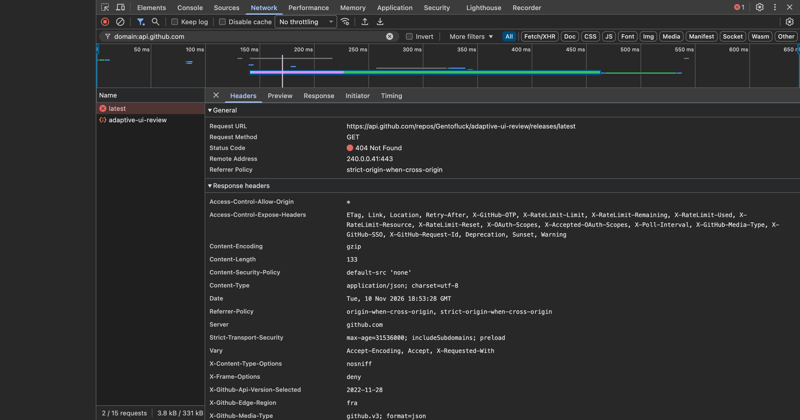
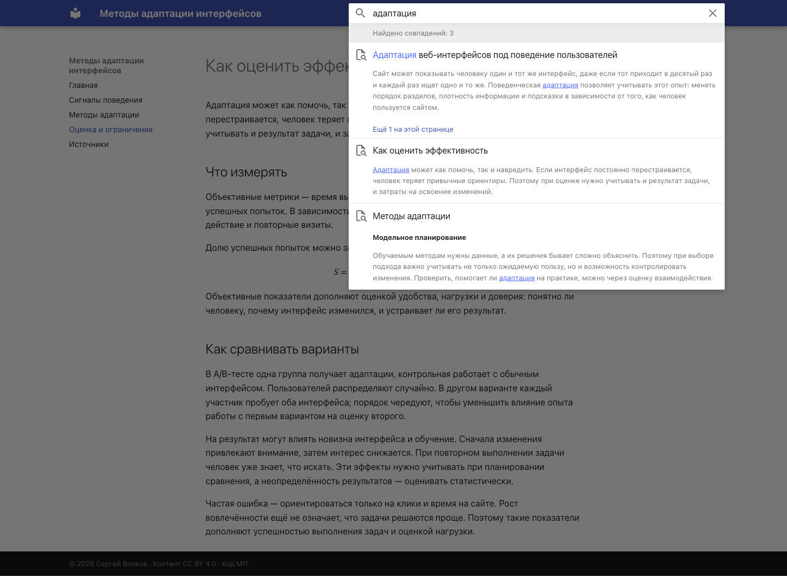

# T4. Доставка и внешние ресурсы

## Способы публикации

| Способ | Необходимый доступ | Последствия утечки | 
|---|---|---|
| Push в `gh-pages` | Токен с правом записи в репозиторий | Злоумышленник сможет отправить в ветку поддельные HTML-файлы или workflow и изменить опубликованный сайт. Насколько далеко он зайдёт — зависит от прав токена |
| `upload-pages-artifact` и `deploy-pages` | `GITHUB_TOKEN` с `pages: write` и `id-token: write` | Здесь токен умеет только публиковать Pages и читать содержимое. Но скомпрометированный workflow всё равно может выложить поддельную сборку |
| SSH с rsync или scp | Отдельный приватный SSH-ключ и проверенный ключ сервера | При утечке ключа злоумышленник получает права аккаунта. В этой настройке доступ не ограничен каталогом сайта: можно менять доступные пользователю файлы и запускать команды |
| FTP | Имя пользователя и пароль | Обычный FTP передаёт учётные данные и файлы без шифрования; перехвативший их сможет менять доступное содержимое |
| SFTP | Учётная запись и пароль или SSH-ключ | Передача шифруется SSH. При утечке ключа или пароля злоумышленник получает права этой учётной записи |
| S3 API | Ключ доступа/секретный ключ либо временные учётные данные | Доступ ограничивается политикой хранилища. При слишком широких правах можно заменить или удалить объекты, в том числе файлы сайта |

В проекте настроены Pages artifact и SSH.

Для pull request из форка GitHub не выдаёт секреты репозитория: автор форка может изменить workflow и попытаться прочитать доступный секрет. Например, изменённый workflow может отправить его на внешний сервер. В этом проекте событие `pull_request` выполняет только строгую сборку; настройка SSH и публикация пропускаются, а `GITHUB_TOKEN` ограничен чтением.

Сторонние Actions в workflow закреплены полными SHA коммитов. Тег вроде `v4` владелец репозитория может передвинуть на другой код; SHA указывает на конкретную ревизию. Supply-chain-атака через Action — это компрометация кода такой зависимости. Запущенный Action может подменить сборку или сайт, а при доступе к секретам — передать их злоумышленнику. Закрепление по SHA не доказывает безопасность Action, но защищает от незаметной подмены через переназначенный тег.

Ключ сервера хранится в `HELIOS_KNOWN_HOSTS`, полученном из проверенного локального `known_hosts`. Workflow записывает его в `~/.ssh/known_hosts`, а в конфигурации установлено `StrictHostKeyChecking yes`. SSH проверяет, совпадает ли предъявленный сервером ключ с сохранённым; при несовпадении подключение останавливается. Проверку ключа хоста не отключал.

## Запросы Material

Настройка `repo_url` включает в теме виджет репозитория. При проверке браузер отправлял два запроса к GitHub API, в том числе `releases/latest`, который вернул 404, поэтому `repo_url` отключён.

Сравнил две сборки одного коммита `7d39b7499a02`; менялась только настройка `repo_url`. Файлы измерены без HTTP-сжатия.

| Показатель | С виджетом | Без виджета |
|---|---:|---:|
| Запросы к GitHub API | 2 | 0 |
| Главная страница, байт | 17 964 | 15 724 |
| Вся сборка, байт | 2 647 915 | 2 634 482 |
| Индекс поиска, байт | 37 000 | 37 000 |
| Время MkDocs, с | 0,14 | 0,21 |

Формула записана в MathML. 

Поиск также работает.

Исходный замер сохранён в [checks.json](checks.json). Workflow публикации: [deploy.yml](../.github/workflows/deploy.yml) и [deploy-helios.yml](../.github/workflows/deploy-helios.yml).
